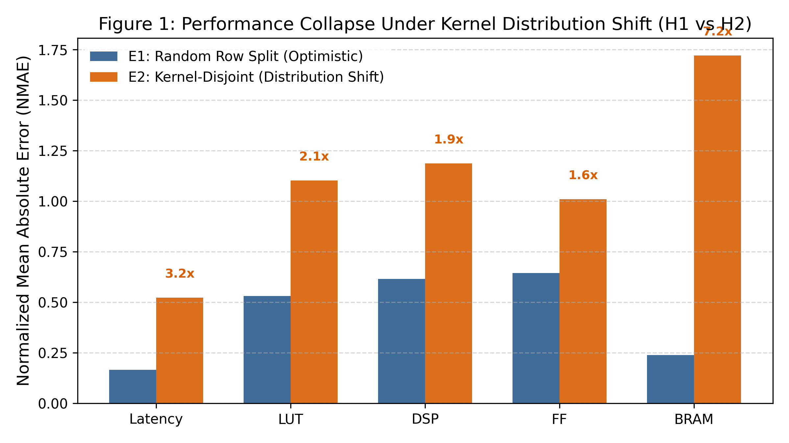
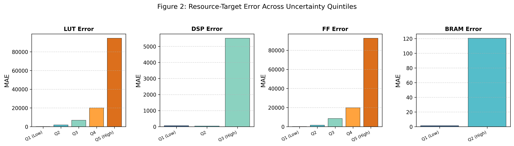
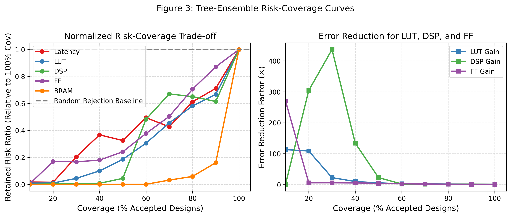
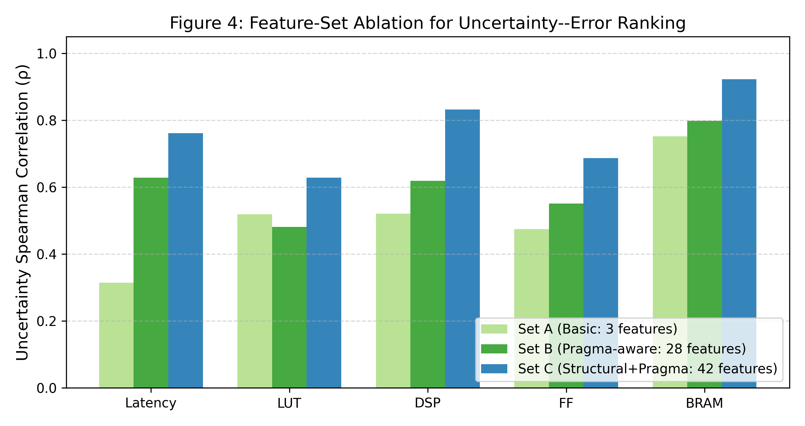

# Reliability-Aware Multi-Objective HLS QoR Prediction Under Kernel-Level Distribution Shift

**Author Name(s)**  
Department or Laboratory, University or Organization  
City, Country  
email@example.com

> **Manuscript status:** Full IEEE-style conference-paper draft. Replace only the
> author and venue placeholders, verify the final synchronized Colab artifacts, and
> transfer this content into the official conference template before submission.

---

## Abstract

Machine-learning models can accelerate high-level synthesis (HLS) design-space
exploration by predicting quality-of-result (QoR) metrics before expensive synthesis.
However, random row-level evaluation can be optimistic when multiple pragma
configurations of the same kernel are distributed across training and test sets. This
paper presents a reliability-oriented evaluation of multi-objective HLS QoR prediction
under kernel-level distribution shift. Using the released ForgeHLS data and its
embedded synthesis-derived measurements, we audit 184,717 records, construct 42
deterministic source/configuration features, and predict worst-case latency, LUT, DSP,
FF, and BRAM\_18K usage. We compare random row splits with group-disjoint splits
defined by source--algorithm kernel groups, repeat the disjoint experiment over five
seeds, and evaluate tree disagreement and deep-ensemble uncertainty. We additionally
measure interval coverage, calibration error, and risk--coverage behavior. The audited
release contains 491 logical kernel groups, and every grouped split has zero
train--test group overlap. Under the disjoint protocol, latency remains the most
predictable target, while resource-target generalization is weak and target-dependent.
Tree disagreement is strongly associated with absolute error, with Spearman
correlations of 0.887--0.976 across the five targets in the verified run. At the same
time, calibration is not uniformly reliable, particularly for heavy-tailed latency and
zero-heavy resources. These results show that HLS QoR predictors should be assessed
not only by point accuracy but also by distribution shift, uncertainty ranking,
calibration, and selective prediction.

**Index Terms—** high-level synthesis, quality of result, distribution shift,
uncertainty quantification, calibration, selective prediction, trustworthy machine
learning

---

## I. Introduction

High-level synthesis translates algorithmic C/C++ descriptions into hardware
implementations. A single source program can generate many implementations through
pragma and configuration choices, creating a large design space in which synthesis is
expensive. Learned QoR predictors are therefore attractive as surrogate models for
design-space exploration (DSE). The central practical question, however, is not only
whether a model fits previously observed kernel families. It is whether its prediction
can be trusted when the next kernel has not appeared in the training data.

Many benchmark evaluations use random row splits. Such a split is convenient, but it
can place different configurations of the same logical kernel in both partitions. The
test set then measures interpolation among related configurations rather than
generalization to an unseen kernel. This distinction is related to broader work on
evaluation under distribution shift and group shifts
[@koh2021wilds; @sagawa2020distributionally; @chen2021mandoline]. It is especially
important for HLS because pragma variants of one program can be numerous and highly
correlated.

This paper studies that reliability problem using the ForgeHLS dataset
[@peng2025forgehls]. We treat the source--algorithm pair as a logical kernel group and
compare an intentionally optimistic random row split with kernel-disjoint evaluation.
We report five-seed repeated results, raw and log-scale errors, uncertainty--error
association, interval calibration, and selective prediction. We also include
validation-only tuning as a secondary analysis rather than presenting it as a
universally superior predictor.

The contributions of this work are:

1. An auditable, leakage-controlled protocol for HLS QoR prediction under kernel-level
   distribution shift.
2. A multi-objective evaluation covering latency and four implementation-resource
   targets on real synthesis-derived records.
3. A reliability analysis combining tree disagreement, deep-ensemble variance,
   calibration, and risk--coverage evaluation.
4. An evidence-based characterization of where tuning helps, where it does not, and
   why target-wise claims are safer than universal accuracy claims.

This paper does **not** claim state-of-the-art point accuracy, perfect calibration,
universal tuning gains, or a cyber-security attack-detection capability.

---

## II. Related Work

### A. HLS QoR Prediction

ForgeHLS provides a large open dataset of HLS source/configuration records and
synthesis-derived QoR measurements [@peng2025forgehls]. Automated HLS exploration
systems such as AutoDSE demonstrate the practical value of reducing manual pragma
tuning [@sohrabizadeh2022autodse]. Classical regressors, tree ensembles, and neural
predictors have been used as surrogates for HLS exploration.
This paper does not claim that the use of a standard regressor is itself novel.
Instead, the focus is the validity and reliability of evaluation when kernel identity
is a source of dependence.

### B. Ensemble-Based Uncertainty

Random forests provide a practical disagreement signal across trees
[@breiman2001random], while deep ensembles provide a complementary predictive-variance
estimate [@lakshminarayanan2017simple]. These signals can be used to rank
predictions by expected risk even when they do not provide formal guarantees of
calibrated predictive intervals.

### C. Calibration and Selective Prediction

Predictive intervals can be evaluated through empirical coverage, interval width, and
calibration error [@guo2017calibration; @kuleshov2018accurate]. Conformal prediction
provides a distribution-free framework under suitable exchangeability assumptions
[@vovk2005algorithmic; @angelopoulos2023conformal; @romano2019conformalized].
Selective classification formalizes the trade-off between coverage and risk
[@geifman2017selective]. Under dataset shift, uncertainty quality can change
substantially [@ovadia2019can]. In this work, uncertainty methods are evaluated as
practical reliability tools. The analysis explicitly reports when uncertainty ranking
is informative but interval calibration remains target-dependent.

---

## III. Dataset and Feature Construction

### A. Observed Data

The verified downloaded ForgeHLS release contains:

| Quantity | Value |
|---|---:|
| Records | 184,717 |
| Unique sources | 11 |
| Unique algorithm names | 471 |
| Source--algorithm groups | 491 |
| Unique design IDs | 1,242 |
| Pareto records | 3,803 |
| Input features | 42 |
| QoR targets | 5 |

Each record contains source/configuration information and five synthesis-derived
targets:

$$
\mathbf{y} =
[\mathrm{Worst\mathchar`-caseLatency},\mathrm{LUT},\mathrm{DSP},
\mathrm{FF},\mathrm{BRAM\_18K}].
$$

The experiments use the real JSON release and regenerate the feature and split
artifacts in the Colab workflow. No synthetic records or imputed target values are
introduced. The dataset audit reports no missing required fields, and the rebuilt
feature matrix reports zero NaNs across all 42 features and 5 targets.

### B. Logical Kernel Grouping

We define a logical kernel group as:

$$
g=(\mathrm{source\_name},\mathrm{algo\_name}).
$$

This grouping is an auditable proxy for kernel identity. It prevents different pragma
and configuration variants of one source--algorithm pair from being placed in both
training and test partitions. The grouping rule is not claimed to prove semantic
equivalence of all programs.

### C. Input Features

The feature extractor produces 42 deterministic features:

- **Set A — Basic:** target clock period, source-code length, and pragma count.
- **Set B — Pragma-aware:** pipeline, unroll, partition, reshape, dataflow, inline,
  resource, binding, storage, and related pragma counts and indicators.
- **Set C — Structural-plus-pragma:** functions, loops, nested loops, branches,
  arrays, operators, memory accesses, and maximum nesting depth.

Source names, algorithm names, design identifiers, and target-derived strategy labels
are not used as model input features. This avoids direct identity memorization and
target leakage.

---

## IV. Evaluation Protocol

### A. Splits

Three evaluation settings are used:

1. **E1: Random row split.** An 80/20 random row split with seed 42. This setting is
   retained as a diagnostic of optimistic interpolation.
2. **E2: Kernel-disjoint split.** An 80/20 group-disjoint split using the grouping rule
   above.
3. **E3: Repeated kernel-disjoint evaluation.** Five group-disjoint splits using seeds
   42, 43, 44, 45, and 46.

Each E3 split contains 392 training groups and 99 test groups. Every E2/E3 split has
zero train--test group overlap. E2 and E3 are therefore the primary estimates of
unseen-kernel generalization; E1 is an optimism diagnostic.

### B. Models

The baseline comparison includes:

- Ridge regression;
- Random Forest [@breiman2001random];
- Gradient Boosting [@friedman2001greedy];
- Multilayer perceptron.

Separate regressors are trained for each target. Validation-only tuning compares
compact Random Forest and Gradient Boosting configurations. The tuned results are
reported as secondary evidence and are not selected by inspecting E3 test results.

### C. Metrics

We report coefficient of determination ($R^2$), mean absolute error (MAE), normalized
MAE, median absolute error, and log-MAE. Log-MAE is emphasized because latency is
heavy-tailed and DSP/BRAM are zero-heavy. Repeated E3 values are reported as mean
plus/minus standard deviation over the five seeds.

### D. Uncertainty, Calibration, and Selective Prediction

For tree disagreement, uncertainty is the standard deviation of tree-level
predictions. For the deep ensemble, uncertainty is the variance of five independently
initialized predictors. We evaluate:

- Spearman correlation between uncertainty and absolute error;
- error in the lowest-uncertainty quintile (Q1);
- error in the highest-uncertainty quintile (Q5);
- 50--95% interval coverage;
- prediction-interval width;
- expected normalized calibration error (ENCE);
- risk--coverage curves.

Risk--coverage curves accept the lowest-uncertainty predictions first and measure how
the accepted-set error changes as coverage increases.

---

## V. Results

### A. Random-Row Versus Kernel-Disjoint Evaluation

Table 1 summarizes representative E1 and E2 results for Random Forest and Gradient
Boosting. Random row splits are substantially more favorable for resources than
kernel-disjoint evaluation. For example, Random Forest LUT $R^2$ decreases from
0.273 to -0.043, DSP from 0.226 to -0.372, and BRAM from 0.852 to -0.024.
Gradient Boosting is the strongest fixed baseline for E2 latency with $R^2=0.782$,
but its resource-target $R^2$ values remain close to zero or negative.

**Table 1. Representative E1 random-row and E2 kernel-disjoint results.** Values are
$R^2$; E2 LogMAE is shown in parentheses.

| Model | Metric | Latency | LUT | DSP | FF | BRAM |
|---|---|---:|---:|---:|---:|---:|
| Random Forest | E1 $R^2$ | 0.965 | 0.273 | 0.226 | 0.160 | 0.852 |
| Random Forest | E2 $R^2$ | 0.731 | -0.043 | -0.372 | 0.012 | -0.024 |
| Random Forest | E2 LogMAE | 1.774 | 0.845 | 0.853 | 1.138 | 0.464 |
| Gradient Boosting | E1 $R^2$ | 0.940 | 0.104 | 0.048 | 0.082 | 0.670 |
| Gradient Boosting | E2 $R^2$ | 0.782 | 0.097 | 0.047 | 0.014 | -0.073 |
| Gradient Boosting | E2 LogMAE | 1.556 | 0.808 | 0.837 | 1.041 | 0.482 |

**Figure 1.** Random-row versus kernel-disjoint normalized MAE; annotations show the
E2/E1 NMAE ratio.

### B. Repeated Kernel-Disjoint Evaluation

Table 2 reports mean and standard deviation across five E3 seeds. Gradient Boosting
gives the strongest fixed-baseline latency result, with
$R^2=0.346\pm0.247$ and LogMAE $1.594\pm0.181$. Resource-target $R^2$ is near
zero for LUT, DSP, and FF. BRAM has high variance for Gradient Boosting,
illustrating why a single split is insufficient for this target.

**Table 2. E3 mean plus/minus standard deviation over five kernel-disjoint seeds.**

| Model | Target | $R^2$ | LogMAE |
|---|---|---:|---:|
| Random Forest | Latency | $-0.819\pm2.226$ | $1.863\pm0.205$ |
| Random Forest | LUT | $-0.027\pm0.031$ | $0.913\pm0.079$ |
| Random Forest | DSP | $-0.076\pm0.148$ | $0.804\pm0.082$ |
| Random Forest | FF | $0.009\pm0.010$ | $1.208\pm0.093$ |
| Random Forest | BRAM | $-0.022\pm0.013$ | $0.387\pm0.082$ |
| Gradient Boosting | Latency | $0.346\pm0.247$ | $1.594\pm0.181$ |
| Gradient Boosting | LUT | $0.021\pm0.038$ | $0.843\pm0.047$ |
| Gradient Boosting | DSP | $0.009\pm0.019$ | $0.708\pm0.083$ |
| Gradient Boosting | FF | $0.014\pm0.012$ | $1.126\pm0.056$ |
| Gradient Boosting | BRAM | $-13.201\pm26.293$ | $0.425\pm0.067$ |

### C. Uncertainty--Error Association

Table 3 gives the verified uncertainty--error associations on the E2 unseen-kernel
test set. Tree disagreement is strongly associated with absolute error, with Spearman
correlations from 0.887 to 0.976. However, this association has an important scale
confound: tree uncertainty is also strongly correlated with predicted magnitude
(approximately 0.945--0.985 in the saved E2 predictions). When the analysis is
stratified by predicted-magnitude deciles, the within-decile uncertainty--error
association is substantially smaller and target-dependent. Thus, the results support
uncertainty as a risk-ranking signal, but do not establish that tree disagreement is
an independent, scale-invariant estimator of error. Deep-ensemble variance is also
informative by rank, but weaker and less uniform than tree disagreement in this run.

**Table 3. Uncertainty--error association on the E2 unseen-kernel test set.**

| Target | Tree Spearman $\rho$ | Deep Spearman $\rho$ | Tree Q5/Q1 Error |
|---|---:|---:|---:|
| Latency | 0.951 | 0.748 | 13,333,226 |
| LUT | 0.887 | 0.750 | 666.7 |
| DSP | 0.906 | 0.602 | 96.0 |
| FF | 0.907 | 0.821 | 750.0 |
| BRAM | 0.976 | 0.904 | 85.7 |

**Figure 2.** Mean absolute error across tree-uncertainty quintiles for LUT, DSP, FF,
and BRAM; latency is reported in Table 3.

### D. Calibration and Selective Prediction

The nominal 80% tree interval coverage is close to nominal for all five targets in
the verified run: 78.6%--83.0%. However, normalized interval width and ENCE remain
target-dependent. Tree ENCE is 6.43 for latency, 1.67 for LUT, 10.20 for DSP, 2.30
for FF, and 3.20 for BRAM. The current tree interval construction is a constant-width
split-conformal-style interval based on calibration residual quantiles; therefore,
near-nominal marginal coverage does not imply input-adaptive calibration.

**Table 4. Calibration metrics from the verified E2 run.**

| Target | Tree PICP at 80% | Tree Normalized MPIW | Tree ENCE | Deep Ensemble ENCE |
|---|---:|---:|---:|---:|
| Latency | 0.7892 | 2.9496 | 6.4317 | 12.9725 |
| LUT | 0.8297 | 2.5570 | 1.6744 | 2.8940 |
| DSP | 0.8045 | 0.8521 | 10.1950 | 4.4865 |
| FF | 0.7931 | 2.4035 | 2.3033 | 3.1036 |
| BRAM | 0.7858 | 1.0431 | 3.1995 | 1.2599 |

The risk--coverage curves support selective use for the tree signal, but the effect is
target-dependent. Deep-ensemble ranking does not provide the same benefit: at 80%
coverage, its retained-error ratio is approximately 0.83--0.93 for the reported
targets, so rejecting its highest-variance predictions can increase error. BRAM
error-reduction factors are omitted from the figure because zero-valued retained errors
create unstable, non-interpretable ratios.

**Figure 3.** Tree-ensemble risk--coverage curves. BRAM error-reduction factors are
omitted because zero-valued retained errors make ratios unstable.

### E. Feature Ablation

The feature ablation compares basic features, pragma-aware features, and
structural-plus-pragma features under grouped evaluation. It reveals a distinction
between point accuracy and uncertainty ranking. Set C gives the strongest
uncertainty--error Spearman correlation for each target in the saved ablation table,
but its grouped point-prediction $R^2$ is poor for several resource targets, including
LUT ($-11.643$), DSP ($-15.064$), and FF ($-2.004$). Figure 4 therefore must not be
interpreted as evidence that Set C is the best QoR predictor. It shows that features
useful for ranking uncertainty need not be the same features that minimize point
prediction error.

**Figure 4.** Effect of feature sets under grouped evaluation.

### F. Validation-Only Tuning

Compact validation-only tuning does not produce a universal improvement. Across E3,
tuned Gradient Boosting improves latency $R^2$ modestly to
$0.386\pm0.240$, but its latency LogMAE is $1.645\pm0.226$, worse than the fixed
baseline. Improvements are target-dependent: FF and BRAM LogMAE improve slightly,
while other targets do not consistently improve. The two-stage zero-aware DSP model
obtains positive-class F1 near 0.847 in E2, but does not dominate the regression
metrics. Accordingly, tuning is treated as a supporting analysis rather than the
paper's main contribution.

**Table 5. Tuned E3 summary.** This table is secondary evidence and should not be
used to claim universal accuracy improvement.

| Model | Target | $R^2$ mean | $R^2$ std | LogMAE mean | LogMAE std |
|---|---|---:|---:|---:|---:|
| Tuned Gradient Boosting | Latency | 0.3856 | 0.2403 | 1.6455 | 0.2257 |
| Tuned Gradient Boosting | LUT | 0.0217 | 0.0497 | 0.8494 | 0.0551 |
| Tuned Gradient Boosting | DSP | 0.0062 | 0.0175 | 0.7159 | 0.0739 |
| Tuned Gradient Boosting | FF | 0.0063 | 0.0066 | 1.1160 | 0.0495 |
| Tuned Gradient Boosting | BRAM | -8.6478 | 19.1957 | 0.4178 | 0.0710 |
| Tuned Random Forest | Latency | -0.7264 | 2.2917 | 1.8660 | 0.2210 |
| Tuned Random Forest | LUT | -0.0326 | 0.0409 | 0.9352 | 0.0834 |
| Tuned Random Forest | DSP | -0.0701 | 0.1520 | 0.8062 | 0.0870 |
| Tuned Random Forest | FF | 0.0080 | 0.0090 | 1.2265 | 0.1110 |
| Tuned Random Forest | BRAM | -0.0268 | 0.0096 | 0.3853 | 0.0826 |

---

## VI. Discussion

The experiments reveal three practical lessons.

First, row-level random splits can conceal the real generalization problem because
related configurations of one kernel occur in both partitions. The strong E1 resource
scores therefore should not be interpreted as evidence of unseen-kernel deployment
performance.

Second, latency is more predictable than the resource targets under the present
feature representation and group shift. Negative or near-zero resource $R^2$ values
are meaningful evidence rather than results to hide. They indicate that the current
features and models do not reliably explain resource variation for unseen kernel
groups.

Third, uncertainty can be operationally useful even when point accuracy is limited:
high uncertainty identifies predictions with larger expected error. Calibration
nevertheless requires separate attention, especially for heavy-tailed latency and
zero-heavy BRAM/DSP.

This work should therefore be positioned as a reliability and evaluation framework,
not as a claim of state-of-the-art point accuracy. The results do not establish
universal superiority of tuned models, perfect calibration, or deployment safety in a
security-critical system.

---

## VII. Threats to Validity and Limitations

1. The study uses one public ForgeHLS release and one grouping rule. Other datasets
   and semantic kernel identities may produce different shift behavior.
2. The source--algorithm pair is an auditable proxy for logical kernel identity, not a
   proof of semantic equivalence.
3. Tree and deep-ensemble uncertainty are practical surrogates; they are not formal
   guarantees of calibrated predictive intervals. The observed tree association is
   partly confounded by predicted scale, and the deep ensemble does not consistently
   improve selective prediction.
4. Resource targets are zero-heavy and latency is heavy-tailed, so raw MAE, $R^2$,
   and error ratios require careful interpretation.
5. The attached call for papers is primarily a communication and information-systems
   security symposium. This manuscript should only be submitted there if the
   organizers explicitly accept trustworthy-AI/HLS methodology. Otherwise, an EDA,
   hardware design, or trustworthy-ML venue is a better fit.

---

## VIII. Reproducibility

The complete workflow regenerates the feature matrix and split files from the
original JSON data, checks required fields, asserts zero group overlap for E2/E3,
trains baselines before uncertainty analysis, and exports CSV, NPZ, figure, and table
artifacts.

The reproducibility package includes:

- `ForgeHLS_colab.ipynb`;
- `hls_ml/scripts/feature_extractor.py`;
- `hls_ml/scripts/build_dataset.py`;
- `hls_ml/scripts/make_splits.py`;
- `hls_ml/scripts/train_baselines.py`;
- `hls_ml/scripts/train_tuned.py`;
- `hls_ml/scripts/train_uncertainty.py`;
- `hls_ml/scripts/evaluate.py`;
- `hls_ml/results/`;
- `hls_ml/figures/`.

Before submission, the authors should archive the exact dataset release identifier,
Python/package versions, notebook, repository commit hash, and final output
checksums. All numerical values in this manuscript must be checked against the final
Drive-synchronized CSV files from one consistent Colab run.

---

## IX. Conclusion

This paper presented a leakage-controlled reliability study of multi-objective HLS
QoR prediction under kernel-level distribution shift. On 184,717 real ForgeHLS
records, random row splits substantially overestimate resource-target generalization
relative to kernel-disjoint evaluation. Repeated grouped evaluation shows that
latency is the strongest target, while resource prediction is weak and unstable.
Tree disagreement provides strong error ranking across all targets, and selective
prediction can prioritize lower-risk designs, but calibration remains
target-dependent. These findings support a reliability-first methodology for HLS
surrogate modeling and caution against reporting random-split accuracy as evidence of
deployment-ready generalization.

---

## Author and Submission Information to Complete Manually

The following values must be supplied by the authors:

- author names;
- affiliations;
- corresponding author;
- email addresses;
- conference name and paper ID;
- funding statement, if applicable;
- conflict-of-interest statement, if required;
- exact ForgeHLS dataset URL/release identifier;
- final repository commit hash;
- final Colab package versions;
- final conference template and page limit.

Do not manually add synthetic records, unverified metrics, fabricated confidence
intervals, security attack results, or unsupported state-of-the-art claims.

---

## References

[@peng2025forgehls] Z. Peng, Z. Li, M. Gao, Q. Xu, C. Zhang, and J. Zhao,
“ForgeHLS: A Large-Scale, Open-Source Dataset for High-Level Synthesis,”
arXiv:2507.03255, 2025.

[@breiman2001random] L. Breiman, “Random Forests,” *Machine Learning*, vol. 45,
no. 1, pp. 5--32, 2001.

[@friedman2001greedy] J. H. Friedman, “Greedy Function Approximation: A Gradient
Boosting Machine,” *The Annals of Statistics*, vol. 29, no. 5, pp. 1189--1232,
2001.

[@vovk2005algorithmic] V. Vovk, A. Gammerman, and G. Shafer, *Algorithmic Learning
in a Random World*. Springer, 2005.

[@guo2017calibration] C. Guo, G. Pleiss, Y. Sun, and K. Q. Weinberger, “On
Calibration of Modern Neural Networks,” in *Proceedings of the 34th International
Conference on Machine Learning*, vol. 70, pp. 1321--1330, 2017.

[@lakshminarayanan2017simple] B. Lakshminarayanan, A. Pritzel, and C. Blundell,
“Simple and Scalable Predictive Uncertainty Estimation using Deep Ensembles,” in
*Advances in Neural Information Processing Systems*, vol. 30, pp. 6402--6413, 2017.

[@ovadia2019can] Y. Ovadia, P. Fertig, J. Ren, Z. Nado, D. Sculley, S. Nowozin,
J. V. Dillon, J. Snoek, and B. Lakshminarayanan, “Can You Trust Your Model’s
Uncertainty? Evaluating Predictive Uncertainty under Dataset Shift,” in *Advances
in Neural Information Processing Systems*, vol. 32, pp. 13969--13980, 2019.

[@kuleshov2018accurate] V. Kuleshov, N. Fenner, and S. Ermon, “Accurate
Uncertainties for Deep Learning Using Calibrated Regression,” in *Proceedings of
the 35th International Conference on Machine Learning*, vol. 80, pp. 2796--2804,
2018.

[@romano2019conformalized] Y. Romano, E. Patterson, and E. J. Candès,
“Conformalized Quantile Regression,” in *Advances in Neural Information
Processing Systems*, vol. 32, pp. 3538--3548, 2019.

[@angelopoulos2023conformal] A. N. Angelopoulos and S. Bates, “Conformal
Prediction: A Gentle Introduction,” *Foundations and Trends in Machine Learning*,
vol. 16, no. 4, pp. 494--591, 2023.

[@geifman2017selective] Y. Geifman and R. El-Yaniv, “Selective Classification for
Deep Neural Networks,” in *Advances in Neural Information Processing Systems*,
vol. 30, pp. 4878--4887, 2017.

[@koh2021wilds] P. W. Koh, S. Sagawa, H. Marklund, S. M. Xie, M. Zhang,
A. Balsubramani, W. Hu, M. Yasunaga, R. L. Phillips, I. Gao, T. Lee, E. David,
I. Stavness, W. Guo, B. Earnshaw, I. Haque, S. Beery, J. Leskovec, A. Kundaje,
E. Pierson, S. Levine, C. Finn, and P. Liang, “WILDS: A Benchmark of in-the-Wild
Distribution Shifts,” in *Proceedings of the 38th International Conference on
Machine Learning*, vol. 139, pp. 5637--5664, 2021.

[@sagawa2020distributionally] S. Sagawa, P. W. Koh, T. B. Hashimoto, and
P. Liang, “Distributionally Robust Neural Networks for Group Shifts: On the
Importance of Regularization for Worst-Case Generalization,” in *International
Conference on Learning Representations*, 2020.

[@chen2021mandoline] M. Chen, K. Goel, N. S. Sohoni, F. Poms, K. Fatahalian,
and C. Ré, “Mandoline: Model Evaluation under Distribution Shift,” in *Proceedings
of the 38th International Conference on Machine Learning*, vol. 139, pp. 1617--1629,
2021.

[@sohrabizadeh2022autodse] A. Sohrabizadeh, C. H. Yu, M. Gao, and J. Cong,
“AutoDSE: Enabling Software Programmers to Design Efficient FPGA Accelerators,”
*ACM Transactions on Design Automation of Electronic Systems*, vol. 27, no. 4,
Article 32, pp. 1--27, 2022, doi: 10.1145/3494534.
